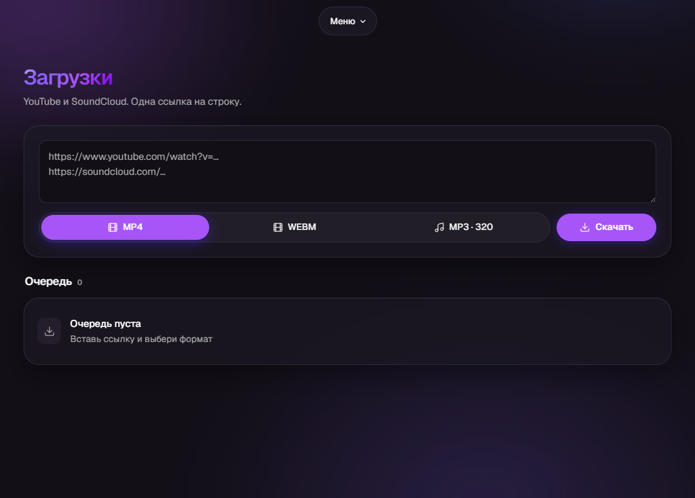
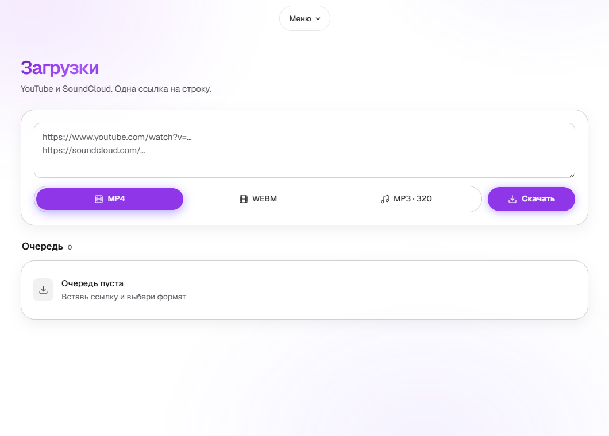
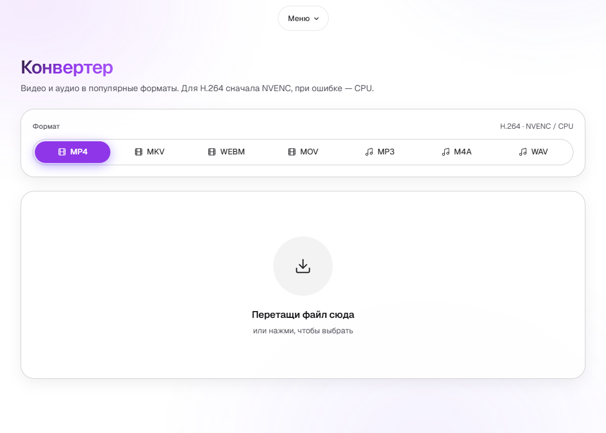

# AVDock

[](https://github.com/Exslayder/AVDock/releases/latest)
[](LICENSE)


Настольное приложение для Windows для скачивания видео и аудио с **YouTube** и **SoundCloud**, а также конвертации видео- и аудиофайлов в популярные форматы с аппаратным ускорением **NVIDIA NVENC**.

- **Репозиторий:** [github.com/Exslayder/AVDock](https://github.com/Exslayder/AVDock)
- **Скачать последнюю версию (v0.2.0):** [github.com/Exslayder/AVDock/releases/latest](https://github.com/Exslayder/AVDock/releases/latest)

---

## Возможности

- **Скачивание с YouTube и SoundCloud** — видео в форматах `MP4` и `WEBM`, аудио в `MP3 (320 kbps)`, поддержка одиночных роликов и плейлистов.
- **Авторежим SoundCloud → MP3** — при вставке ссылки на SoundCloud формат автоматически переключается на `MP3 · 320`, а видеоформаты блокируются.
- **Обложки и ID3-теги** — автоматическое встраивание обложки и метаданных в `MP3`.
- **Очередь-стопка** — активная загрузка отображается на переднем плане с живым графиком скорости, прогрессом и оставшимся временем (ETA), а остальные задачи аккуратно сложены стопкой и раскрываются по наведению или кнопке «Показать все».
- **Конвертер видео и аудио (Drag & Drop + NVENC)** — перетащите файл в окно приложения и конвертируйте:
  - **Видео:** `MP4`, `MKV`, `WEBM`, `MOV` (для `H.264` сначала используется аппаратный кодировщик `NVIDIA NVENC` с автоматическим откатом на `CPU libx264`; для `WEBM` — `VP9 + Opus`).
  - **Аудио:** `MP3 (320 kbps)`, `M4A (AAC 256 kbps)`, `WAV (PCM 16-bit)`.
- **Интерактивный интерфейс** — верхнее выдвижное меню-пилюля, пружинные переключатели форматов, локальные шрифты `Geist` и `Bricolage Grotesque`, системная, тёмная и светлая темы, русский и английский языки.
- **Автообновление и чистота системы** — движок загрузок и само приложение обновляются автоматически (с компактным индикатором прогресса в правом нижнем углу), а временные файлы в `data\tmp` автоматически очищаются при запуске и после завершения очереди.

---

## Скриншоты

Тёмная тема:



Светлая тема:



Конвертер:



---

## Установка

В релизе [AVDock v0.2.0](https://github.com/Exslayder/AVDock/releases/latest) доступны две сборки:

1. **Установочная версия** — `AVDock_0.2.0_x64-setup.exe`
   Ставится без прав администратора в `%LOCALAPPDATA%\Programs\AVDock`, создаёт ярлык в меню «Пуск». `ffmpeg` уже встроен в пакет.
2. **Портативная версия** — `AVDock_0.2.0_portable.zip`
   Распакуйте архив целиком в любую папку и запустите `AVDock.exe` (рядом должна оставаться папка `resources\ffmpeg.exe`).

> Инсталлятор не подписан коммерческим EV-сертификатом, поэтому при первом запуске Windows SmartScreen может показать предупреждение: нажмите **«Подробнее» → «Выполнить всё равно»**.

---

## Где хранятся данные и временные файлы

Приложение хранит все свои файлы в папке `data` рядом с `AVDock.exe`:

- **Портативная версия** — `<папка с AVDock.exe>\data`
- **Установленная версия** — `%LOCALAPPDATA%\Programs\AVDock\data`
- **Резервный путь** (если папка программы недоступна для записи, например в `Program Files`) — `%APPDATA%\com.exslayder.avdock`

Структура папки `data`:

```text
data\
├─ settings.json      настройки приложения (папки сохранения, язык, тема, автообновление)
├─ bin\               бинарник движка загрузок (скачивается и обновляется автоматически)
└─ tmp\               временные фрагменты активной загрузки
```

Папка `data\tmp` автоматически очищается при каждом старте приложения и сразу после завершения очереди загрузок, поэтому недокачанные фрагменты не остаются на диске.

---

## Автообновление

- **Движок загрузок** проверяется при запуске приложения и автоматически устанавливается или обновляется в `data\bin` с отображением прогресса в правом нижнем углу.
- **AVDock** при включённом автообновлении проверяет `latest.json` в последнем релизе GitHub, скачивает подписанный пакет обновления и перезапускается. Пользовательские настройки в `data` при этом сохраняются.
- В разделе **«Настройки → Обновления»** можно отключить автообновление при запуске или вручную проверить обновления движка и приложения.

---

## Технологический стек

| Слой | Технология |
|---|---|
| Интерфейс | React 19 + TypeScript 5.9 + Vite 8 |
| Шрифты | Geist Variable + Bricolage Grotesque Variable (локально через `@fontsource-variable`) |
| Иконки | Lucide (`lucide-react`) |
| Анимации | Motion (`motion/react`) + `anime.js` |
| График скорости | Recharts |
| Нативная оболочка | Tauri 2 + Rust (Tokio, Reqwest, Serde) |
| Кодирование медиа | `ffmpeg.exe` (H.264 NVENC / libx264, VP9, MP3 LAME, AAC, WAV PCM) |

---

## Разработка и локальная сборка

### Требования

- **Windows 10 / 11 (x64)**
- **Node.js 20+** и `npm`
- **Rust (stable, MSVC)**
- Бинарник `ffmpeg.exe` в `src-tauri/resources/ffmpeg.exe` (скачивается скриптом)

### Запуск в режиме разработки

```powershell
npm install

# Скачать ffmpeg.exe в src-tauri/resources/ffmpeg.exe (если ещё не скачан)
powershell -ExecutionPolicy Bypass -File scripts/get-ffmpeg.ps1

npm run tauri dev
```

### Проверка типов и сборка фронтенда

```powershell
npm run build
cd src-tauri; cargo check
```

### Локальная релизная сборка

```powershell
$env:TAURI_SIGNING_PRIVATE_KEY = Get-Content .tauri-keys/avdock.key -Raw
$env:TAURI_SIGNING_PRIVATE_KEY_PASSWORD = ""
npm run tauri build
```

Готовые артефакты создаются в:

- `src-tauri\target\release\bundle\nsis\AVDock_0.2.0_x64-setup.exe`
- `src-tauri\target\release\bundle\nsis\AVDock_0.2.0_x64-setup.exe.sig`
- `src-tauri\target\release\avdock.exe`

---

## Выпуск релиза (CI/CD на GitHub Actions)

Официальные релизы собираются автоматически на **GitHub Actions** (`.github/workflows/release.yml`) в чистом окружении `windows-latest`:

1. Обновите версию в `package.json`, `src-tauri/Cargo.toml` и `src-tauri/tauri.conf.json` (а также не забудьте обновить тег версии в бейдже `README.md`).
2. Закоммитьте изменения, создайте тег версии и отправьте в GitHub:

   ```powershell
   git add -A
   git commit -m "Release v0.2.0"
   git tag v0.2.0
   git push origin main --tags
   ```

3. Workflow **Release** автоматически:
   - установит Node.js, Rust и скачает свежий `ffmpeg.exe`;
   - соберёт и подпишет инсталлятор `AVDock_0.2.0_x64-setup.exe` (`.sig`);
   - упакует портативный архив `AVDock_0.2.0_portable.zip`;
   - сгенерирует манифест автообновления `latest.json`;
   - опубликует готовый GitHub Release со всеми файлами.

Также сборку можно запустить вручную во вкладке **Actions → Release → Run workflow**, указав номер версии.

### Секреты репозитория для подписи автообновлений

В настройках репозитория (**Settings → Secrets and variables → Actions**) используются:

- `TAURI_SIGNING_PRIVATE_KEY` — содержимое приватного ключа `.tauri-keys/avdock.key`
- `TAURI_SIGNING_PRIVATE_KEY_PASSWORD` — пароль ключа (пустой, если ключ создан без пароля)

> Папка `.tauri-keys/` добавлена в `.gitignore` и никогда не коммитится в репозиторий.

---

## Структура проекта

```text
avdock/
├─ .github/workflows/
│  └─ release.yml                CI/CD сборка и публикация релизов на GitHub Actions
├─ docs/screenshots/             скриншоты интерфейса для README и релизов
├─ public/
│  └─ theme-init.js              ранняя инициализация темы без вспышки при старте
├─ scripts/
│  └─ get-ffmpeg.ps1             автоматическая загрузка ffmpeg.exe для сборки
├─ src/                          фронтенд (React 19 + TypeScript)
│  ├─ components/
│  │  ├─ TopNav.tsx              интерактивное верхнее меню-пилюля с пружинной анимацией
│  │  ├─ Downloads.tsx           ввод ссылок, выбор формата и очередь-стопка (QueueStack)
│  │  ├─ Converter.tsx           Drag & Drop конвертер, кольцо прогресса и история
│  │  ├─ SettingsPage.tsx        настройки папок, языка, темы и обновлений
│  │  ├─ YtdlpToast.tsx          плавающий индикатор загрузки и статуса движка
│  │  ├─ RubberSegmented.tsx     резиновый сегментированный переключатель
│  │  ├─ LoadingSuccessButton.tsx кнопка с переходом Загрузка → Готово
│  │  ├─ SpeedChart.tsx          живой график скорости загрузки
│  │  ├─ Meter.tsx               индикатор прогресса
│  │  └─ Icons.tsx               набор иконок
│  ├─ lib/
│  │  ├─ api.ts                  обёртки над командами и событиями Tauri
│  │  ├─ format.ts               форматирование байтов, скорости, времени и ошибок
│  │  ├─ i18n.tsx                локализация (RU / EN)
│  │  └─ types.ts                общие TypeScript-типы
│  ├─ styles/
│  │  └─ reactbits.css           тема оформления (токены, стекло, aurora, spotlight)
│  ├─ App.tsx                    корневой компонент, загрузка шрифтов и подписка на события
│  ├─ main.tsx                   точка входа React и подключение локальных шрифтов
│  └─ styles.css                 базовая разметка и стили компонентов
├─ src-tauri/                    бэкенд (Rust + Tauri 2)
│  ├─ capabilities/              разрешения Tauri 2 ACL
│  ├─ icons/                     иконки приложения
│  ├─ resources/                 ffmpeg.exe (игнорируется в git)
│  ├─ src/
│  │  ├─ lib.rs                  регистрация команд Tauri и инициализация
│  │  ├─ state.rs                состояние приложения, очередь и широковещательные события
│  │  ├─ queue.rs                фоновый воркер очереди и автоочистка tmp
│  │  ├─ download.rs             запуск движка загрузок и парсинг прогресса
│  │  ├─ convert.rs              кодирование через ffmpeg (NVENC / CPU / VP9 / Audio)
│  │  ├─ bins.rs                 управление бинарниками движка и ffmpeg
│  │  ├─ updates.rs              проверка и установка обновлений движка и приложения
│  │  ├─ paths.rs                портативная папка data, миграция и очистка data/tmp
│  │  └─ settings.rs             чтение и сохранение settings.json
│  ├─ Cargo.toml
│  └─ tauri.conf.json
├─ index.html
├─ LICENSE                       лицензия MIT
├─ package.json
├─ tsconfig.json
└─ vite.config.ts
```

---

## Лицензия

Проект распространяется под лицензией [MIT](LICENSE).
